# GymLog

A personal workout tracker for Android (Flutter + Firebase). Log sets as you train, see what you lifted last time, and track personal records and progression per exercise.

## Screenshots

<p align="center">
  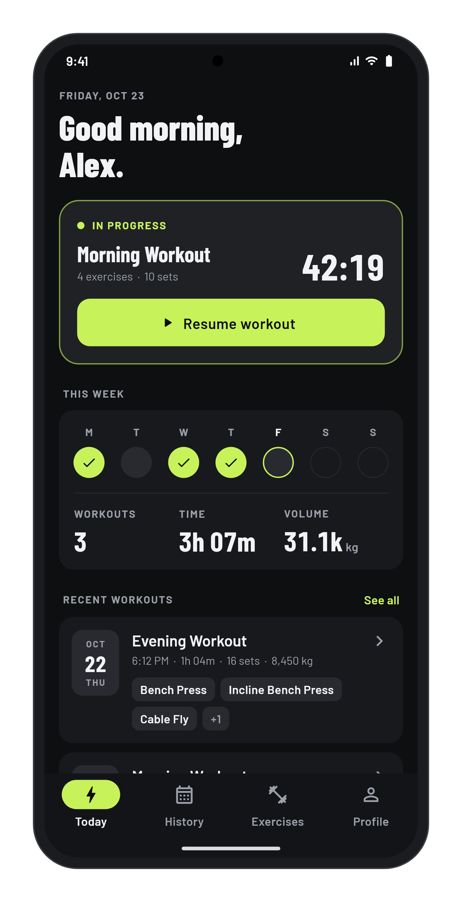
  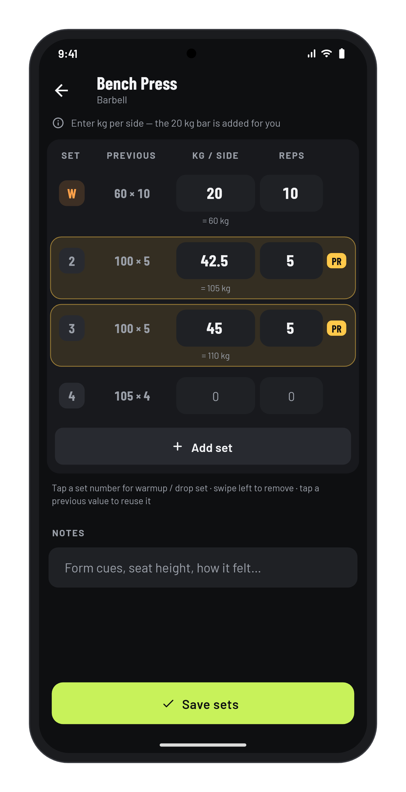
  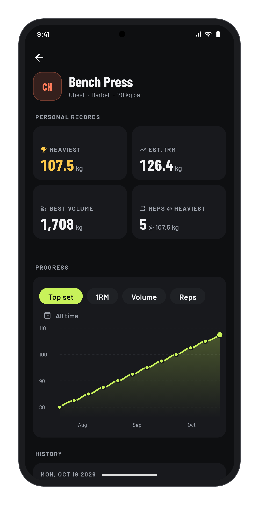
  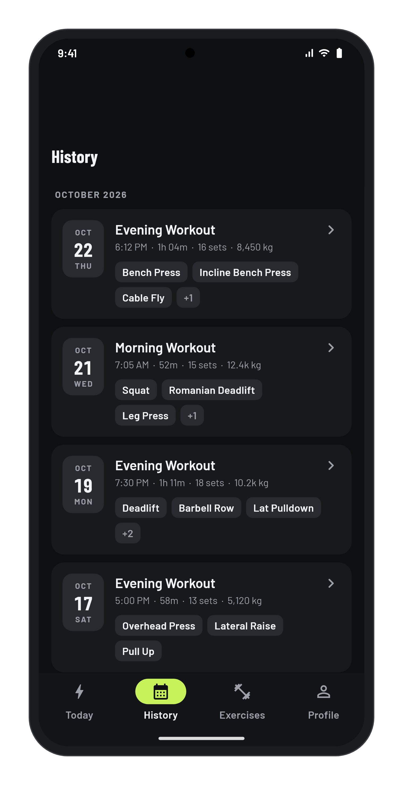
</p>

<details>
<summary>More screens</summary>
<br>

| Sign in | Today | Active workout | Add exercise |
|:---:|:---:|:---:|:---:|
| 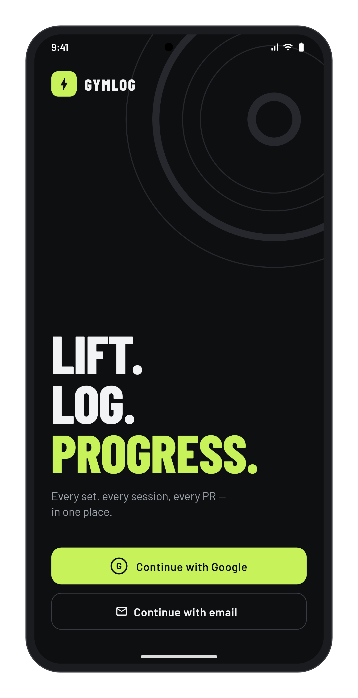 | 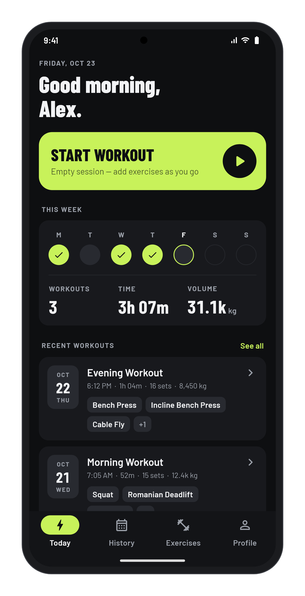 | 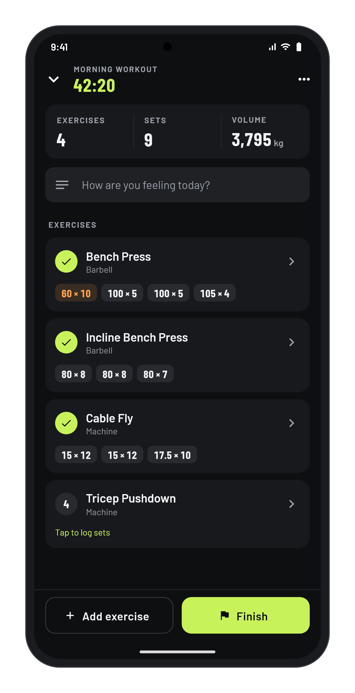 | 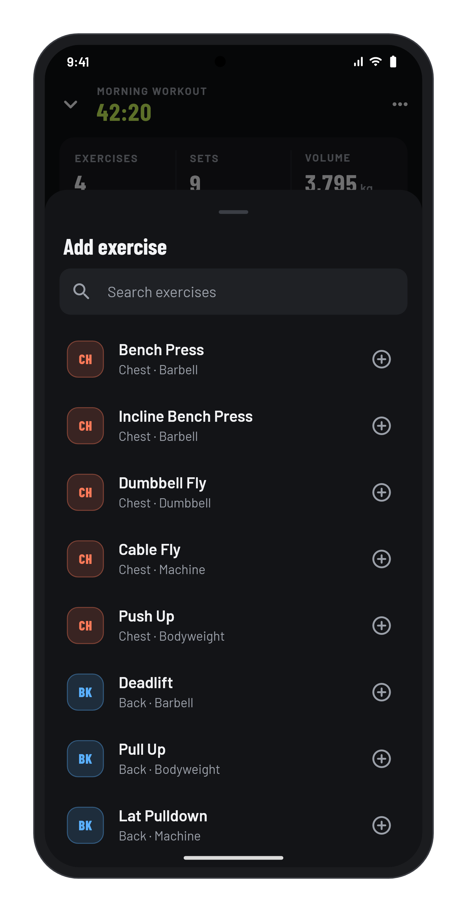 |

| Workout detail | Exercises | Profile | Light theme |
|:---:|:---:|:---:|:---:|
| 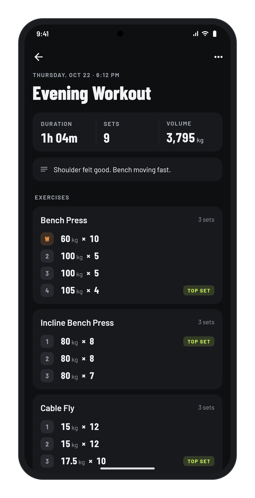 | 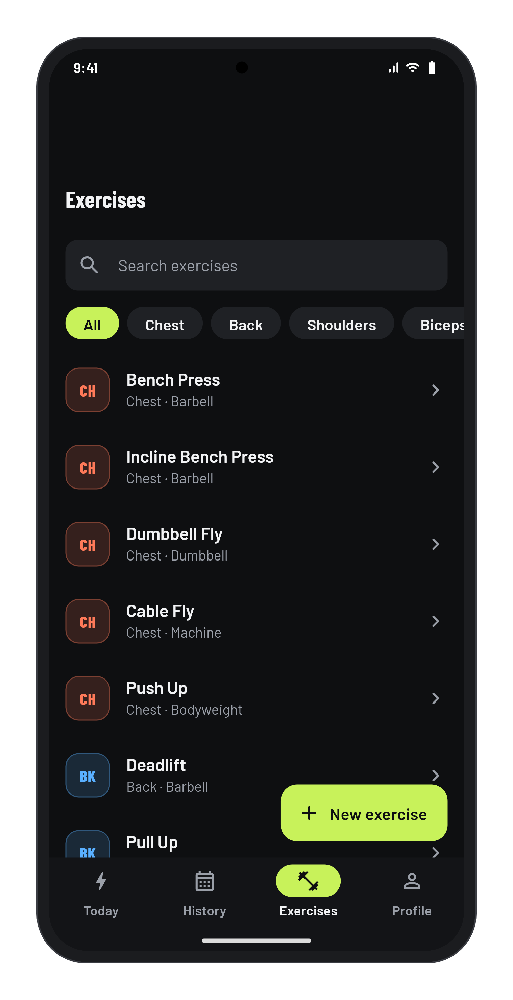 | 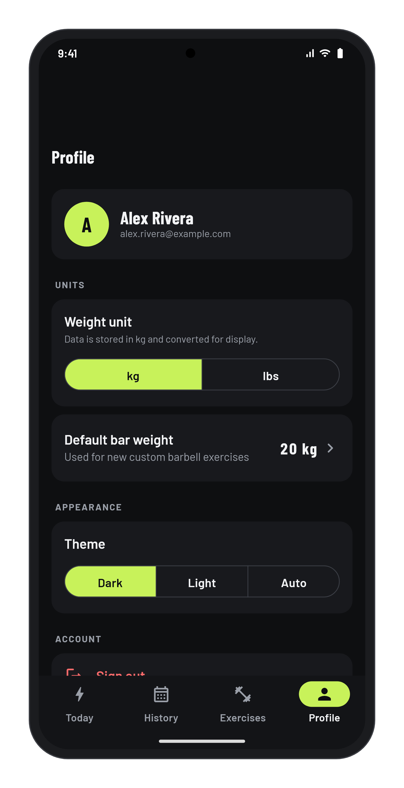 | 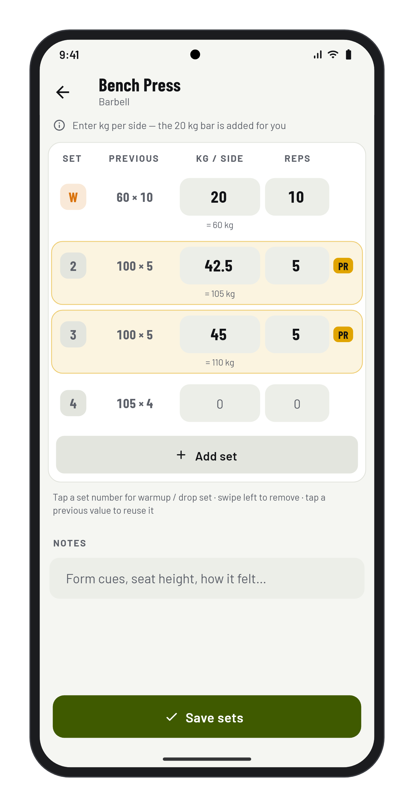 |

</details>

## Features

- **Workouts** — start an empty session, add exercises from your library, log sets with a running timer. One in-progress workout at a time; it survives app restarts.
- **Set logging** — table with your previous session's numbers next to each set (tap to reuse them). Barbell/smith weights are entered per side and dumbbells per hand; totals are computed for you. Mark warmup and drop sets.
- **Personal records** — new PRs are flagged live while logging (warmups excluded). Per-exercise records and a progression chart (top set, estimated 1RM, volume, reps).
- **History** — finished workouts grouped by month, with duration, sets and volume.
- **Exercise library** — 40+ built-in exercises seeded on first sign-in, plus your own custom ones.
- **Settings** — kg/lbs (data is always stored in kg), default bar weight, dark/light theme.
- Works offline (Firestore offline persistence); syncs when back online.

## Tech stack

- Flutter (Dart `^3.11.3`), Material 3 with a custom theme
- State: `flutter_bloc`
- Firebase: Auth (Google + email/password) and Cloud Firestore
- Charts: `fl_chart`

## Getting started

### Prerequisites

- Flutter SDK (stable) and Android Studio / Android SDK
- JDK 17+ for Android builds
- Firebase CLI (`npm install -g firebase-tools`) — only needed to deploy Firestore rules and indexes

### Run

```bash
flutter pub get
flutter run
```

The Firebase project is **`gym-log-49fbf`**. Its Android config (`android/app/google-services.json`) and `lib/firebase_options.dart` are committed. To point the app at a different Firebase project, run `flutterfire configure`.

### Deploy Firestore rules and indexes

The app's history queries need the rules and composite index defined in this repo. Deploy them whenever `firestore.rules` or `firestore.indexes.json` change:

```bash
firebase login
firebase deploy --only firestore
```

`.firebaserc` already selects `gym-log-49fbf`. Deploying **replaces** the rules in the Firebase console, so make sure the file is the source of truth. After deploying, wait until the index shows as *Enabled* (Firebase console → Firestore → Indexes) before using the app.

## Development

```bash
flutter analyze                                       # lint
flutter test                                          # all tests
flutter test test/blocs/session_bloc_test.dart        # one file
flutter test --plain-name "part of a test name"       # one test
```

Tests cover the blocs (with mocked repositories via `mocktail` / `bloc_test`) and the calculation helpers. Firebase is never initialized in tests.

### Project layout

```
lib/
  blocs/          Bloc/Cubit per feature (session, exercise logger, history, library, settings, auth)
  repositories/   All Firestore / Auth access
  models/         Plain value classes (toMap / fromMap)
  screens/        UI, one folder per area; shell/ holds the bottom navigation
  widgets/        Shared UI pieces
  theme/          Colors, typography and component styles (app_theme.dart)
  utils/          Weight, unit and metric calculations; formatters
assets/
  exercises.json  Built-in exercise library
  fonts/          Barlow / Barlow Condensed (OFL) — bundled so the app works offline
docs/mockups/     Framed screenshots used in this README
tool/mockups/     Generator for docs/mockups (not run by `flutter test`)
```

See [CLAUDE.md](CLAUDE.md) for a deeper architecture overview: Firestore data layout, how the history queries work, and the logger's save behaviour.

### Data

All data lives under `users/{uid}/` in Firestore (exercises, sessions, and each session's exercises). Weights are stored in kg. Older data is migrated automatically in the background after sign-in.

## Troubleshooting

**Corporate network / HTTPS-inspecting proxy.** Errors like `self-signed certificate in certificate chain` (Firebase CLI) or `PKIX path building failed` (Gradle) mean a proxy is re-signing HTTPS traffic. Make the tools trust the Windows certificate store:

- **Firebase CLI (Node 22.15+):**
  ```powershell
  $env:NODE_OPTIONS = "--use-system-ca"     # this terminal only
  setx NODE_OPTIONS "--use-system-ca"       # permanently (open a new terminal)
  ```
- **Gradle:** add to `~/.gradle/gradle.properties` (user-level, not the repo):
  ```properties
  systemProp.javax.net.ssl.trustStoreType=Windows-ROOT
  systemProp.javax.net.ssl.trustStore=NUL
  ```
  This needs a JDK that includes `jdk.crypto.mscapi`. Android Studio's bundled JBR does not, so build with a regular JDK 17:
  ```bash
  flutter config --jdk-dir="C:\Program Files\Java\jdk-17"
  ```
  In Android Studio, set *Settings → Build Tools → Gradle → Gradle JDK* to the same JDK.

Avoid `NODE_TLS_REJECT_UNAUTHORIZED=0`: it turns off certificate checking entirely.

**`Plugin 'com.android.internal.application' relies on ... InternalProblems`.** The Gradle wrapper was upgraded past what the Android Gradle Plugin supports. AGP 8.x needs Gradle 8.x; keep `android/gradle/wrapper/gradle-wrapper.properties` on 8.14 unless you also upgrade AGP in `android/settings.gradle.kts`.

## Platform status

- **Android** — supported.
- **iOS** — Firebase is configured in `firebase_options.dart`, but Google Sign-In still needs `GoogleService-Info.plist` and its URL scheme; untested.
- **Web / desktop** — not configured.

## License

Fonts: Barlow, © The Barlow Project Authors, SIL Open Font License 1.1 (`assets/fonts/OFL.txt`).
